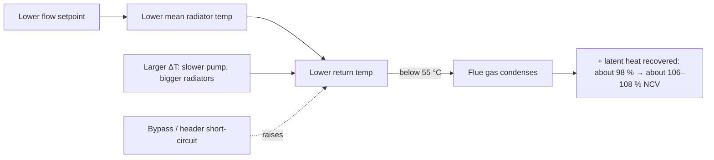

# 01 · Heating basics: heat loss, radiators and condensing

[← Index](README.md) · Next: [02 OpenTherm →](02-opentherm.md)

Before any control algorithm, three physical facts decide what is possible:
1. how much heat the house loses;
2. how much heat the radiators can give at a given water temperature;
3. how efficiently the boiler makes that heat at that water temperature.

## 1. The house loses heat in proportion to the temperature difference

To a first approximation, heat loss is

$$Q_{loss} = UA \cdot (T_{room} - T_{out})$$

where *UA* (kW/K) is the house's overall heat-loss coefficient. It comes from the design heat loss the installer calculates. For example, 10 kW at −13 °C outside and 21 °C inside gives UA = 10 / 34 ≈ 0.29 kW/K.

So **the load scales linearly with the outdoor temperature**. At +5 °C the same house needs only 0.29 × 16 ≈ 4.7 kW, and at +10 °C about 3.2 kW. Keep that in mind; it comes back in chapter 05.

The building also stores heat: walls, floors, furniture and water. Its **time constant** τ = C/UA is typically tens of hours for a masonry house. That is why rooms respond slowly, and why an aggressive controller overshoots.

## 2. Radiators: output falls steeply as water cools

A radiator's output follows the EN 442 law

$$Q = Q_{50} \cdot \left(\frac{T_{mean} - T_{room}}{50}\right)^{n}, \quad n \approx 1.3$$

*Q₅₀* is the catalogue rating at a 50 K difference between mean water and room temperature. With a 20 °C room:

| Mean water temp | 70 °C | 60 °C | 55 °C | 50 °C | 45 °C | 40 °C | 35 °C |
|---|---|---|---|---|---|---|---|
| Output fraction | 1.00 | 0.75 | 0.63 | 0.51 | 0.41 | 0.30 | 0.21 |

Combine this with section 1. On a mild day the house needs perhaps 40 % of design heat, so the radiators only need a mean of about **45 °C**. With the pump keeping a 15 K flow–return difference, that is about 52 °C flow and 37 °C return. **Lower water temperature is enough most of the season.** That is the whole idea behind weather and load compensation.

▶ Deeper: why the exponent bends the heating curve

Solve the radiator law for the mean water temperature needed to cover a load *Q*:

$$T_{mean} = T_{room} + 50\left(\frac{Q}{Q_{50}}\right)^{1/n}$$

With *n* = 1.3, the exponent 1/n ≈ 0.77 is below 1. Halving the load does **not** halve the temperature above room; it reduces it to 0.5^0.77 ≈ 59 %. So the "needed flow vs outdoor temperature" line is slightly concave. Commercial heating curves, and SAT's formula with its quadratic term, are bent for this reason. Try it in [heating-curve.html](interactive/heating-curve.html).

Measured double-panel radiators sometimes fit *n* ≈ 1.5 better ([OpenEnergyMonitor](https://community.openenergymonitor.org/t/rating-radiators-at-off-design-conditions/27313)).

## 3. Condensing: return temperature is the efficiency dial

Burning natural gas produces water vapour. A condensing boiler cools the flue gas below its **dew point (≈ 55.6 °C)** so the vapour condenses and releases its latent heat ([Bosch](https://www.bosch-industrial.com/africa/media/country_pool/knowledge/technical-reports/whitepaper_condensing.pdf)). The flue gas meets the coolest water in the heat exchanger, which is the **return** water. So:

The Tera's own datasheet shows what is at stake ([V1 manual](https://www.immergas.com/media/Prodotto/63cc198a3fdcb6a15d98b7c7/Victrix-Tera-Plus-24-1046002_002_01180.pdf)):

| Flow/return | Efficiency (NCV) |
|---|---|
| 80/60 °C | 97.8 % |
| 50/30 °C | 106.1 % |
| 40/30 °C | ≈108 % |

That ≈10-point gap is the "condensing prize". Efficiencies above 100 % appear only because boiler figures use the *net* calorific value, which ignores latent heat. The theoretical ceiling is about 111 % NCV.

👉 **Play with it:** [interactive/condensing.html](interactive/condensing.html) shows return temperature, efficiency and yearly gas difference.

▶ Deeper: what actually raises the return temperature

- **High flow setpoint**, the obvious one: on/off thermostats usually run 65–80 °C flow.
- **Small ΔT**: an over-fast pump returns water almost as hot as it left. The Tera's pump runs constant ΔT by default (parameter A3 = 15 K), which helps.
- **Bypasses**: the Tera has an internal bypass that leaves the factory *open*. Automatic bypass valves and low-loss headers with a too-strong primary pump send hot flow straight back to the return ([Heat Geek](https://www.heatgeek.com/low-loss-headers/)).
- **Unbalanced systems**: field data cited by Danfoss shows boilers condensing about 5 % of the time unbalanced vs about 80 % balanced ([HVP/Danfoss](https://www.hvpmag.co.uk/Danfoss-outlines-the-benefits-of-heating-system-balancing/13075)).
- **DHW tank charging**: the Tera charges the tank at DHW setpoint + 25 K by default (A4), so a 50 °C tank is heated with 75 °C water, which never condenses (chapter 06).

## 4. Two more losses that matter as much

- **Cycling losses.** Each burner start purges the combustion chamber with cold air and runs inefficiently for the first minutes. UCL's lab data: a 3-minute burn loses about 1.5 % efficiency, a 1-minute burn about 4 % and a 10-second burn about 12 % ([UCL](https://discovery.ucl.ac.uk/10054754/1/StartStop_BG_Paper_BSERT_v4_final_main_updated_figures_references.pdf)). Chapter 05 is all about this.
- **Room setpoint.** Every 1 °C lower room temperature saves roughly 10 % ([BRE 2017](https://assets.publishing.service.gov.uk/media/5a81f66ced915d74e62350ca/heating-controls-compensation-tpi-bre.pdf)). Tight, stable control that lets you accept 20.5 instead of 21.5 °C can beat any clever algorithm.

## ✅ Check yourself

1. The house loses 10 kW at −13 °C with a 21 °C room. Roughly what does it need at +8 °C?
2. Why does lowering the flow temperature from 70 to 50 °C help efficiency, even though the boiler burns the same gas to deliver the same heat?
3. Name two things other than the flow setpoint that can keep the return above 55 °C.

Answers

1. UA = 10/34 ≈ 0.294 kW/K, so at +8 °C the load is 0.294 × 13 ≈ **3.8 kW**. That is less than the Tera's 4.3 kW minimum output, so the boiler will have to cycle (chapter 05).
2. It doesn't burn the same gas. A cooler return lets the flue gas condense and recover latent heat, so the same useful heat needs less gas (about 98 % vs about 106 % NCV).
3. Any two of: a small ΔT from an over-fast pump, an open bypass or low-loss header short-circuit, an unbalanced system, DHW tank charging at a high flow temperature.

## 🔧 What this means for our thermostat

- Control the **flow temperature**, not just on/off. Every degree of flow we don't need costs efficiency.
- Log **return temperature (ID 28)** from day one. "% of burner time with return < 55 °C" is the core efficiency KPI (chapter 09).
- Efficiency is bounded by the installation: ask the installer about the bypass, pump mode and balancing (installer checklist in [ch. 10](10-recommendation-phase1.md#installer-checklist)).
