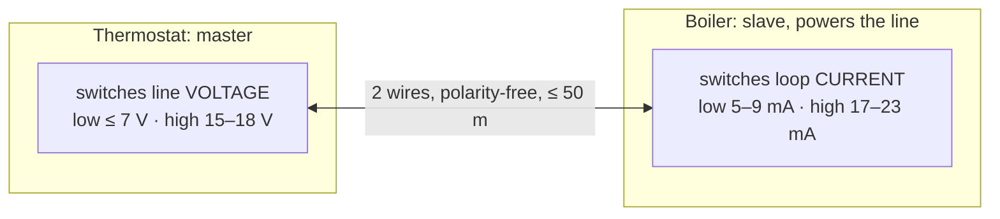
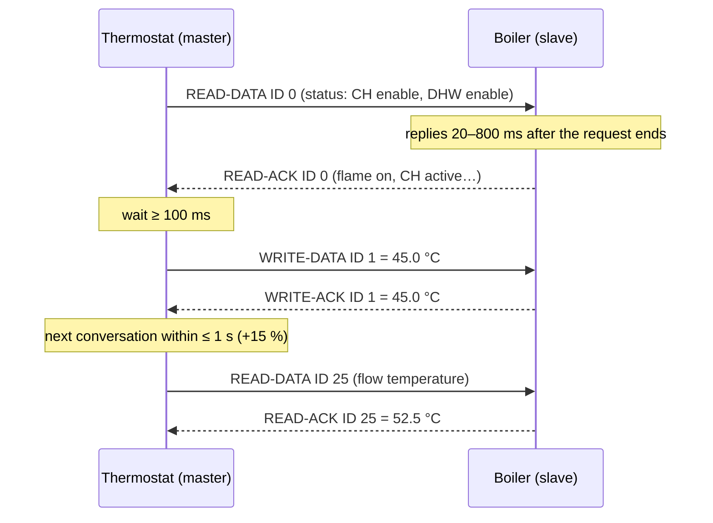
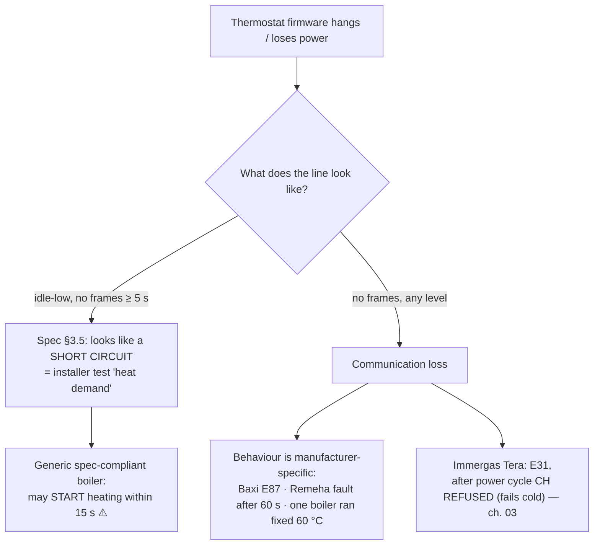
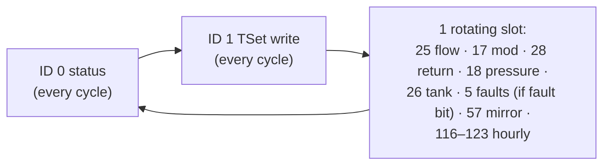

# 02 · OpenTherm in depth

[← 01 Heating basics](01-heating-basics.md) · [Index](README.md) · Next: [03 Victrix Tera →](03-victrix-tera-24-plus.md)

OpenTherm is a two-wire, point-to-point link between a **master** (the thermostat) and a **slave** (the boiler). The master asks; the boiler answers. All spec references are to the freely circulating **OpenTherm Protocol Specification v2.2** ([PDF mirror](http://ihormelnyk.com/Content/Pages/opentherm_library/Opentherm%20Protocol%20v2-2.pdf)). Later versions (v3, v4.x) are licensed to OpenTherm Association members only.

👉 **Hands-on:** [interactive/opentherm-frame.html](interactive/opentherm-frame.html) lets you build frames, see their bits, parity and waveform, and decode frames from logs.

## 1. The wire: voltage one way, current the other

- The **boiler powers the line**. A line-powered thermostat may draw at most about 5 mA (about 35 mW). Our ESP32-P4 with a display obviously can't run on that, so it is **locally powered**, which the spec allows. The **DIYLESS Master shield** does exactly this: it is powered from the MCU side and polarity doesn't matter ([DIYLESS (mirror)](https://diyless-old.duckdns.org/product/master-opentherm-shield)).
- **Bits:** Manchester / bi-phase-L at 1000 bit/s. A `1` is an active→idle transition in the middle of the bit, a `0` is idle→active. The receiver re-synchronises on every edge; mid-bit edges may be 900–1150 µs apart.
- **Frame:** start bit `1` + 32 data bits + stop bit `1` = **34 ms** on the wire.

## 2. The 32-bit frame

| Bit | 31 | 30–28 | 27–24 | 23–16 | 15–8 | 7–0 |
|---|---|---|---|---|---|---|
| Field | **P**arity | **MSG-TYPE** | spare (0) | **DATA-ID** | DATA-VALUE high byte | DATA-VALUE low byte |

- **Parity** makes the total number of `1` bits even. Any parity or Manchester error discards the whole frame. "No errors are treated as recoverable"; the master simply tries again in the next slot.
- **Message types**, master → boiler: `READ-DATA (0)`, `WRITE-DATA (1)`, `INVALID-DATA (2)`. Boiler → master: `READ-ACK (4)`, `WRITE-ACK (5)`, `DATA-INVALID (6)`, `UNKNOWN-DATAID (7)`.
- **Data types:** `flag8`, `u8`, `s8`, `u16`, `s16`, and **`f8.8`**, signed fixed point with 1/256 resolution. For example, 45.0 °C = `0x2D00` and 52.5 °C = `0x3480`.

▶ Worked example: "write CH setpoint 45 °C"

- Type `WRITE-DATA` = 001, Data-ID 1 = `0x01`, value 45.0 in f8.8 = `0x2D00`.
- Without parity: `0x10012D00`. Count the 1-bits: `0x1` → 1, `0x01` → 1, `0x2D` → 4, `0x00` → 0; total 6, which is even, so the parity bit is 0.
- Frame: **`0x10012D00`**. The boiler answers `WRITE-ACK` (type 5) with the same ID. Accepted as is, that is `0xD0012D00`: type 101 adds a 1-bit, so the parity bit flips to 1. If the boiler clamped the value, the reply carries the **modified** value instead.

## 3. Timing: one conversation at a time, at least once a second

Rules from spec §4.3.1:
- the boiler answers **20–800 ms** after the request;
- the master waits **≥ 100 ms** before the next request;
- the master **must communicate at least every 1 s (+15 %)**.

In practice a conversation takes 250–400 ms, and Immergas boilers reportedly answer within tens of ms. One DIYLESS user on an Immergas still lost **17.6 %** of replies ([diyless #32](https://github.com/diyless/opentherm-thermostat3/issues/32#issuecomment-5373052226)). A missed reply is routine, not an emergency.

## 4. The Data-IDs that matter

The mandatory core is small:
- the master must read **ID 0** (status) and write **ID 1** (CH setpoint), and read **ID 3** (slave config) at start-up;
- the boiler must answer **ID 14, 17 and 25**.

Everything else may legitimately return `UNKNOWN-DATAID`, and the master must cope.

| ID | Name | Dir / type | Notes for this project |
|---|---|---|---|
| 0 | Status | R, flag8/flag8 | Master HB: b0 CH enable, b1 DHW enable, b2 cooling, b3 OTC active, b4 CH2; v4: b5 summer/winter (polarity disputed), b6 DHW blocking. Slave LB: b0 fault, b1 CH active, b2 DHW active, **b3 flame**, b5 CH2, b6 diagnostic. **Immergas: request LB = 0xCA** |
| 1 | TSet | W, f8.8 | CH flow setpoint: **the main control lever** |
| 2 | Master config | W | flags 0, MemberID 0 |
| 3 | Slave config | R | DHW present, modulating vs on/off, DHW storage tank, CH2 present |
| 4 | Remote command | W | 1 = lock-out reset; never in a loop |
| 5 | Faults + OEM code | R | Service, low pressure, flame, air, over-temperature |
| 6 | Remote-parameter flags | R | Are IDs 56/57 transferable/writable? |
| 8 | TsetCH2 | W | Second circuit; rarely implemented |
| 14 | Max relative modulation | W, % | Some boilers ignore it or misbehave if spammed; write **on change** |
| 15 | Max capacity / min modulation | R | Anchors low-load logic |
| 16 / 24 | Room setpoint / room temperature | W | Informational for most boilers |
| 17 | Relative modulation | R, % | 0 % = *minimum* fire, not off |
| 18 | CH pressure | R, bar | Leak alarm |
| 19 | DHW flow | R | Absent on tank boilers like ours |
| 25 / 28 | **Flow / return temperature** | R | Return = the condensing KPI |
| 26 / 27 / 33 | DHW (tank) / outside / exhaust temperature | R | Model-dependent |
| 48 / 49 | DHW / max-CH setpoint bounds | R | Read before writing 56/57 |
| 56 / 57 | DHW setpoint / max CH setpoint | R/W | May be panel-only on the Tera with P7 = 2 |
| 115 | OEM diagnostic code | R | |
| 116–123 | Starts and hours counters | R | Burner starts, burner hours… |
| 124–127 | Versions | W/R | Declare honestly (2.2) |

Full bit-level tables: [notes/opentherm_protocol.md](notes/opentherm_protocol.md).

### Rules a good master follows

- A reply is valid only if the parity is right, the type is a slave type, and the **Data-ID echoes the request**.
- **"Unsupported" ≠ "link down."** Mark an ID unsupported after 3 consecutive `UNKNOWN-DATAID` replies, as OTGW does, and re-probe it occasionally.
- **CH enable has priority over the setpoint.** To stop heating, clear the bit; on Immergas, *also* send ID 1 = 10 °C (chapter 03).
- Write configuration-like IDs (14, 56, 57) **only when they change**. One tado wrote ID 14 every 6 s and the boiler stopped modulating ([tado community](https://community.tado.com/en-gb/discussion/19468/adding-new-id-to-opentherm-communication)).
- Read back the `WRITE-ACK`: the boiler may have clamped the value.

## 5. OT/+, OT/−, Smart Power

- **OT/+** is the full digital protocol above.
- **OT/− ("Lite")** uses the same wire with a 100–500 Hz PWM whose duty cycle sets the setpoint (< 5 % = CH off). A master tries OT/+ for 20 s at power-up before falling back.
- **Smart Power** (v3.0) lets a line-powered master ask for more current; its signalling was never published.

None of these matter for a locally powered master on a modern boiler.

## 6. Failure modes: the counter-intuitive part

- The spec requires every boiler to treat **shorted terminals as a heat demand**, an installer test feature that may be detected as "line low with no valid frame for ≥ 5 s" (spec §3.5). Electrically, an idle line looks the same. So on a spec-literal boiler, **a hung master can cause heating, not stop it.** OTGW drives the line high when the thermostat goes quiet for exactly this reason. It also drops external setpoint overrides that aren't refreshed within a minute ([OTGW](https://otgw.tclcode.com/firmware.html)).
- Beyond that, the spec does **not** define what a boiler does on comms loss.

⚠️ **Verify on the real boiler:** with P7 = 2, what does the Tera do when the line is idle-low, idle-high, or the shield is unpowered? (Tests 18–20 in [ch. 10](10-recommendation-phase1.md#verify-on-the-real-boiler).)

## 7. Message loop design

A typical robust loop (≈1 conversation per second) runs:

At start-up the master reads ID 0 several times, then ID 3. It writes ID 2 and ID 124 = 2.2, reads 125/127, 15, 6, 48/49, and probes the optional IDs.

▶ Deeper: the MCU side

- The popular Ihor Melnyk library bit-bangs 500 µs half-bits with `delayMicroseconds`, decodes in a pin-change ISR with a 750 µs threshold, times out after 1 s and waits 100 ms after each reply ([OpenTherm.cpp](https://github.com/ihormelnyk/opentherm_library/blob/master/src/OpenTherm.cpp)).
- ESPHome warns that code which disables interrupts (Dallas 1-Wire, for example) causes invalid frames; its `sync_mode` "usually won't eliminate them entirely" ([ESPHome](https://esphome.io/components/opentherm/)).
- Our firmware already uses a **GPTimer for TX and a GPIO edge ISR for RX** on a dedicated high-priority task. That is the right architecture on an ESP32-P4 that is also busy with Wi-Fi, display and camera. Test 25 in ch. 10 checks frame errors with the camera and Wi-Fi active.

## ✅ Check yourself

1. Decode `0x40193480`. Who sent it, and what does it say?
2. The boiler answers `UNKNOWN-DATAID` to ID 28. Is the link broken?
3. Why must the master keep sending at least once per second even when nothing changes?
4. What is dangerous about a thermostat that hangs with its output idle-low?

Answers

1. Type 4 = `READ-ACK` (boiler → thermostat), ID 0x19 = 25 (flow temperature), value `0x3480` = 52.5 °C. The parity bit is 0 because the other 31 bits already contain eight 1s (an even number).
2. No. The boiler is alive and says it doesn't support return temperature. Mark it unsupported and stop asking, re-probing occasionally.
3. The spec requires it (≤ 1.15 s), and boilers treat silence as comms loss. On the Tera that means E31 and no heating.
4. On a spec-literal boiler, idle-low for ≥ 5 s looks like the installer "short-circuit = heat demand" test, so the boiler may start heating with no controller watching.

## 🔧 What this means for our thermostat

- Keep the existing hardware-timed PHY on its own high-priority task, and **never stop the cadence**, even during OTA or Wi-Fi reconnects.
- Track a **per-ID support map**; separate "unsupported" from "link lost". Declare loss only after about 5 s of consecutive failures, and alarm without stopping transmission.
- Decide and test the **failure direction** in hardware (watchdog plus fallback relay, ch. 10).
