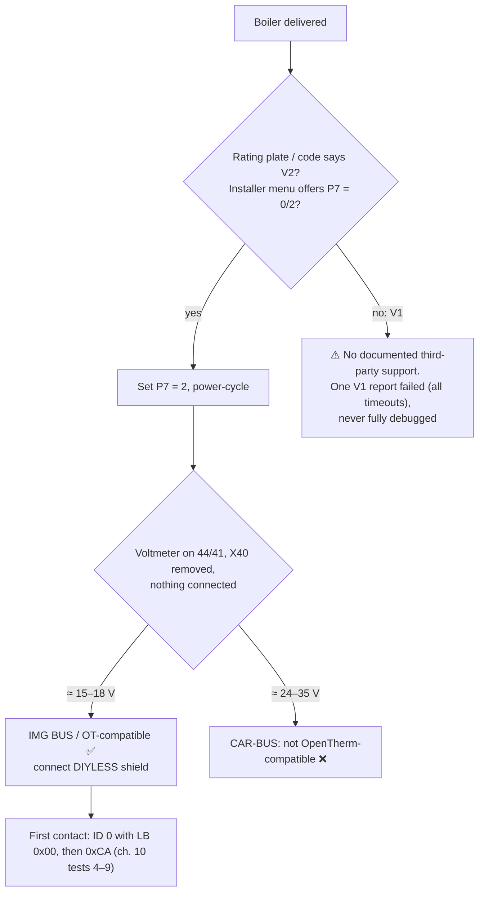
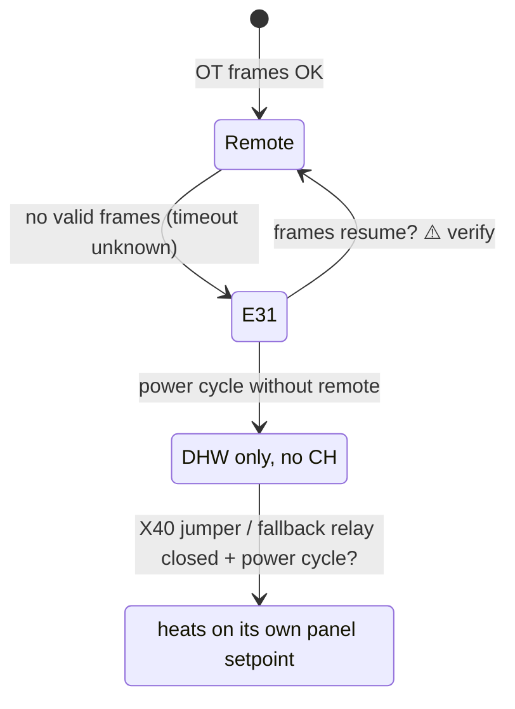

# 03 · The Victrix Tera 24 Plus and its Immergas dialect

[← 02 OpenTherm](02-opentherm.md) · [Index](README.md) · Next: [04 Control strategies →](04-control-strategies.md)

This chapter is the most important for Phase 1. Whether the thermostat can drive the boiler at all depends on details specific to Immergas.

Primary sources:
- the Immergas installer manuals for the original model ([V1, STD.008065/002](https://www.immergas.com/media/Prodotto/63cc198a3fdcb6a15d98b7c7/Victrix-Tera-Plus-24-1046002_002_01180.pdf)) and the V2 model ([V2, STD.009317/003](https://gimli.freetls.fastly.net/tavolla/Products/Attachments/40503/inst.pdf));
- the Hungarian manuals on immergas.hu;
- code and issues of open-source OpenTherm projects.

Details: [notes/victrix_tera_24_plus.md](notes/victrix_tera_24_plus.md) and [notes/immergas_opentherm_compat.md](notes/immergas_opentherm_compat.md).

## 1. What the boiler is

| | Victrix Tera 24 Plus (V1) | Victrix Tera **V2** 24 Plus EU |
|---|---|---|
| Type | System (heating-only) condensing boiler with internal 3-way valve for an external tank | same |
| CH output | 24.1 kW | 24.0 kW |
| Tank charging output | 28.3 kW | 28.0 kW |
| **Minimum output** | **4.3 kW** | **4.3 kW** |
| Turndown | ≈ 5.6 : 1 (minimum ≈ 18 % of CH nominal) | same |
| Efficiency 80/60 → 40/30 (NCV) | 97.8 % → ≈ 108 % | ≈ same |
| Pump | PWM Grundfos UPM3/UPM4, constant ΔT 15 K by default (A3) | same |
| Bypass | internal, adjustable, **open from factory** | same |
| **Third-party remote (P7 = 2)** | ❌ "not available on this model" | ✅ |

## 2. IMG BUS, P7 and why "V2" matters

Immergas never uses the word "OpenTherm" for the Tera. Its remote-control bus is **IMG BUS**: "almost OT, but improved a bit", in the words of a technician, or "Open Therm modificato" according to Immergas support ([HA community](https://community.home-assistant.io/t/immergas-victrix-integration-with-ha/395191); [plcforum](https://www.plcforum.it/f/topic/304253-immergas-vitrix-tera-nest-heat-link/)).

The decisive official text is in the **V2 manual**: installer parameter **P7 "Comando remoto"**
- `0` = IMG BUS (Immergas remotes such as CAR V2 / "Amico V2" in Hungarian)
- `2` = **"comando remoto commerciale ai morsetti 44/41"**, a third-party remote on terminals 44/41.
- With P7 = 2, "the DHW and max CH flow settings remain available on the boiler panel." So the boiler may **ignore writes to ID 56/57**.

On V1 the same parameter reads "not available on this model". **The Hungarian Plus manuals on immergas.hu are still the V1 version**, so for a 2026 purchase the order, invoice and rating plate should all say **V2** (code 3.032933).

**Wiring:** the remote goes on terminals **41 and 44/40** after removing jumper **X40**. Only one remote may be connected. The manual says "respect polarity"; the DIYLESS shield is polarity-free. The same terminals take a volt-free on/off contact, which must be "clean" (potential-free) or the board is damaged. There is no 0–10 V input and no Immergas OpenTherm kit.

## 3. The quirks the firmware needs

| Quirk | What | Evidence |
|---|---|---|
| **0xCA** | Send ID 0 READ-DATA with **low byte 0xCA** instead of 0x00: data `0x03CA` with CH+DHW enabled. "Without the first step, writes … change nothing." | OTGateway's "Fix for Immergas boilers" changes exactly this one byte ([OpenThermTask.h](https://github.com/Laxilef/OTGateway/blob/master/src/OpenThermTask.h)). Found experimentally on an Eolo Star ([arduino.ru](https://arduino.ru/forum/programmirovanie/termostat-opentherm-na-esp8266?page=15)) |
| **ID 57 mirror** | Write the same value to ID 57 (max CH setpoint) as to ID 1 | Some Immergas boilers "acknowledge ID 1 and heat to ID 57" ([jotuera hub](https://raw.githubusercontent.com/jotuera/immergas-modbus-bms-nasa-opentherm-hub/main/docs/opentherm-hub.md)); OTGateway option "sync max heating temp" |
| **Explicit off** | When CH is off: clear the CH bit **and** send ID 1 = 10 °C | "Some boilers keep firing to the last flow setpoint with only the CH bit cleared"; a Fantini chrono on a Tera TT kept heating while switched off ([plcforum](https://www.plcforum.it/f/topic/304469-victrix-tera-24-netatmo-modulante-opentherm/)) |
| **Don't write TSP 12** | SAT and OTGW firmware write Immergas parameter 12 via ID 11 | Meaning undocumented, never tested on a real boiler; MemberID 27 is shared with Sime. Read, don't write |
| **ID 19 missing** | DHW flow rate is not reported on tank models | Immergas via a Zeus owner |
| **ID 17 > 100 %** | Modulation can exceed 100 % during DHW | jotuera hub |

All three main quirks should be **configuration flags** in the firmware, so each can be tested on and off on the real boiler.

## 4. Field reports

| Boiler | Master | Result |
|---|---|---|
| **Victrix Tera 24 Plus** | OTGateway + DIYLESS shield, 0xCA fix | **Works** (Jan 2026) ([#3](https://github.com/Laxilef/OTGateway/issues/3#issuecomment-3801355953)) |
| **Victrix Tera 24 Plus** ("original, ~2021") | ESP32 + DIYLESS | **All timeouts**; bus voltage, pin swap and P7 never checked ([#284](https://github.com/Laxilef/OTGateway/issues/284)) |
| Victrix Tera 28 | DIYLESS on 40/41, fix | Works except DHW flow |
| Victrix Exa 24 / Zeus 25 | DIYLESS Master shield, fix | Works; some sensors not reported |
| Victrix Zeus 25 / Omnia | DIYLESS Thermostat 3 | Works but **short-cycles** at low setpoints (ch. 05) |
| Victrix Tera 24 | Nest Heat Link | Works with modulation, about 45 °C flow; only DHW max settable |
| Victrix Tera 24 **V2** | tado | Works after **P7 = 2** (one report) |

The pattern is clear. Ordinary OpenTherm masters drive the Tera family, and the DIYLESS shield is the most-reported working hardware. **No report confirms a V1 unit working**, which is why the V2 matters.

## 5. Installer parameters the thermostat must live with

| Parameter | Meaning | Default | Why it matters |
|---|---|---|---|
| **P7** (V2) | Remote protocol | 0 | must be **2** |
| P1 / P2 | Min / max CH power | P2 ≈ 83–85 % | caps output; may set ID 17's ceiling |
| P4 | Pump: 0 intermittent, 1 continuous | 0 | |
| t0 / t1 | Min / max CH setpoint | 25 / 85 °C | boiler-side clamp on ID 1. Suggest ≈ 30 / 60 °C |
| t3 | DHW priority hold | "2" (≈ 20 s?) | |
| **t4** | Re-ignition (anti-cycle) timer | "18" → probably **180 s** | minimum off-time the thermostat cannot beat |
| t5 | Ramp to max power | ≈ 180 s | soft start |
| A3 | Pump ΔT mode | 15 K | large ΔT → cooler return |
| A4 / A5 | Tank charge flow offset / tank hysteresis | 25 K / 3 K | tank charge flow = DHW set + A4 (ch. 06) |
| S2 | Ignition fan speed | 44 × 50 rpm | ignition burst |

The boiler protects itself with:
- **frost protection** below 4 °C water temperature, and a radiator anti-freeze cycle to 42 °C if the return drops below 4 °C. Both stay active in stand-by, *not* in "off";
- daily pump and valve anti-seize;
- a lockout after 5 resets (E08).

The **outdoor sensor** (terminals 38–39), if fitted to the boiler, "always acts, whatever room control is used". How it interacts with an OpenTherm setpoint is undocumented.

▶ Deeper: useful info-menu items for cross-checking what we read over OpenTherm

- d0.2 flow, d0.4 CH set, d0.7 tank temperature, d0.8 return, d0.9 fault history
- d1.4 pump flow, d1.5 fan rpm, d1.6 flue temperature, d1.7 calculated setpoint, d1.9 software versions

Bench test 11 in ch. 10 compares ID 17 against fan rpm (d1.5) to map "modulation %" to real kW.

## 6. E31: this boiler fails **cold**

The manual: **E31 = loss of communication with the remote**; reset by power cycle. "If at power-up the remote control is not detected, the boiler goes to local mode… the 'Heating' function cannot be activated." **DHW still works, CH does not**, until a remote is back or X40 is restored and the boiler is power-cycled. Unlike some other Immergas models, the Tera has no documented "keep heating on remote loss" option.

This **reverses** the generic OpenTherm hazard of ch. 02. There, a dead master might mean runaway heat; on the Tera it means **an unheated house in winter**, protected only by the 4 °C frost function. The proposed mitigation is a **relay contact across 44/40–41**, held open while a hardware watchdog confirms the firmware is alive. When the watchdog expires, the relay closes and re-creates "X40 present".

⚠️ **Verify on the real boiler:**
- how long before E31 appears;
- whether CH resumes without a power cycle;
- whether the fallback relay is accepted without a power cycle;
- whether the idle-line "short-circuit = heat" rule still applies with P7 = 2.

## ✅ Check yourself

1. The installer says "it's the Victrix Tera 24 Plus". Is that enough?
2. Your thermostat sends ID 1 = 45 °C, gets `WRITE-ACK`, but the boiler heats to 85 °C. What are the two Immergas-specific suspects?
3. Why might "CH enable = 0" alone not stop the burner?
4. The thermostat's power supply fails on a January night. What happens with and without the fallback relay?

Answers

1. No. Confirm it's the **V2** (code 3.032933, P7 present in the installer menu), then set P7 = 2.
2. The missing **0xCA** status byte (writes acknowledged but ignored), and the boiler heating to **ID 57** (max CH setpoint) rather than ID 1. Mirror ID 1 into ID 57, or check t1.
3. Some Immergas boilers keep firing to the last setpoint; also send ID 1 = 10 °C.
4. Without the relay: E31, and the boiler stops CH; after any power cycle it stays in "no CH" mode, and the house cools until someone intervenes. With the relay: it closes, the boiler sees an on/off contact and heats on its own panel setpoint (subject to the power-cycle question still to be verified).

## 🔧 What this means for our thermostat

- Make **0xCA, ID 57 mirroring and "explicit off" configuration flags**, default on for Immergas, and verify each on the boiler.
- Treat ID 56/57 writes as *maybe ignored*: write, read back, compare with the panel.
- Design the **hardware fallback** (watchdog + relay) into Phase 1. Don't add it later.
- Change the current firmware failsafe (heating off after 30 s of sensor loss) to "keep the bus alive, CH at a conservative fixed setpoint" (ch. 10).
