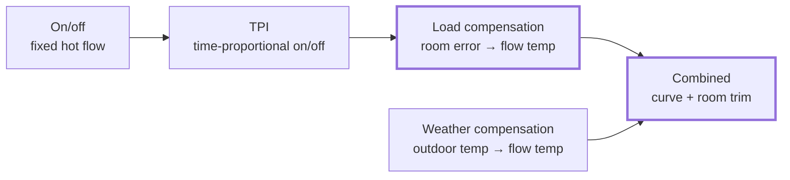
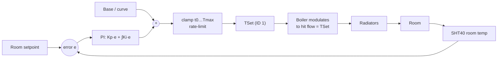

# 04 · Control strategies: from on/off to curve + PI

[← 03 Victrix Tera](03-victrix-tera-24-plus.md) · [Index](README.md) · Next: [05 Low load and cycling →](05-low-load-cycling.md)

The thermostat has two outputs: **CH enable** (on/off) and **TSet**, the flow temperature (ID 1). A control strategy is simply a rule for choosing them.

👉 **Hands-on:**
- [interactive/heating-curve.html](interactive/heating-curve.html) shows what flow temperature the house needs, and how a heating curve approximates it;
- [interactive/room-sim.html](interactive/room-sim.html) runs four strategies side by side.

## 1. The ladder

| Strategy | Inputs | How TSet is chosen | ErP class (credit) |
|---|---|---|---|
| On/off | room | fixed (e.g. 70 °C); CH enable toggles around the setpoint ± hysteresis | I (+1 %) |
| TPI | room | fixed; on-fraction of a 10–20 min period ∝ room error | IV (+2 %) |
| **Load compensation** | room | **PI(D) of room error** | **V (+3 %)** |
| Weather compensation | outdoor | **heating curve** f(T_out) | II (+2 %) |
| **Weather + room sensor** | outdoor + room | curve + room trim | **VI (+4 %)** |
| Multi-sensor | ≥ 3 rooms | aggregated | VIII (+5 %) |

The credits come from EU Reg. 811/2013. BRE notes their technical origin "is not stated" ([BRE 2017](https://assets.publishing.service.gov.uk/media/5a81f66ced915d74e62350ca/heating-controls-compensation-tpi-bre.pdf)).

**Why compensation saves energy:** at low demand it runs a lower flow temperature, so the return is cooler and the boiler condenses (ch. 01). BRE's modelled gains grow steeply as the design temperatures fall: load or weather compensation gives **0.7 % at 80/60, 3.4 % at 55/47 and 6.1 % at 45/39**.

**Measured evidence is thin:**
- Salford tests sponsored by the industry body BEAMA: about **12 %** for directly modulating load or weather compensation;
- the only large field trial (TPI, about 50 homes) showed no significant difference;
- a BEIS review found "limited international evidence".

The honest expectation is **a few percent of gas**, more if the system really runs at 45/35-type temperatures.

## 2. Load compensation: a PI controller on the room error

$$T_{Set} = \mathrm{clamp}\Big(T_{base} + K_p\,e + \tfrac{K_p}{T_i}\!\int e\,dt,\; T_{low},\; T_{max}\Big)$$

- **Kp** is in "°C of flow per K of room error". About **10–15** is a sensible start: a 0.5 K error raises the flow by 5–7 °C.
- **Ti** (integral time) of **2–3 h** suits a slow building.
- **No derivative** to begin with; the room is too slow and noisy.
- **Sample every 60 s**, with a 0.1 K deadband and a TSet rate limit of about 1 K/min.
- **Anti-windup:** freeze the integral while saturated, during DHW priority, in duty-cycle OFF phases and during anti-cycle waits.

▶ Deeper: how SAT and ESPHome tune it

SAT, an open-source Home Assistant integration that drives OpenTherm boilers, uses ([pid.py](https://github.com/Alexwijn/SAT/blob/master/custom_components/sat/pid.py)):
- a 1 min sample time and a 0.1 K deadband;
- Kp = coef · curve / 3, about 13–25 °C/K for radiators;
- Ki = Kp / 8400 s⁻¹, an integral time of about 2.3 h;
- Kd = 588 · Kp, a derivative time of about 10 min, double-EMA filtered and only used outside the deadband;
- an integral clamped to ± the curve value, updating only inside the deadband.

ESPHome's documented example (`kp 0.4, ki 0.004` on a normalised 20–65 °C output) lands in the same range ([ESPHome](https://esphome.io/components/opentherm/)).

Good practice:
- **derivative on measurement**, so setpoint changes don't kick the output;
- **conditional integration** for anti-windup.

SAT wants a room sensor with 0.01 °C resolution, refreshed every 30 s. The SHT40 qualifies once the board's self-heating is calibrated out (bench test 26 in ch. 10).

## 3. Weather compensation: the heating curve

A heating curve maps outdoor temperature to flow temperature. Commercial controllers describe it with a **slope** and a **parallel shift**:
- Siemens: slope = (flow at −5 °C − flow at +15 °C) / 20 K;
- Vaillant: "slope" and "level".

The open-source **SAT curve** is

$$T_{flow} = b + \frac{c}{4}\Big[4(T_{target}-20) + 0.03(T_{out}-20)^2 - 0.4(T_{out}-20)\Big]$$

with base *b* = 27.2 °C for radiators (20 °C for underfloor) and coefficient *c* ≈ 2. At a 20 °C target it gives **37.2 °C at 0 °C outside and 46.7 °C at −10 °C** ([heating_curve.py](https://github.com/Alexwijn/SAT/blob/master/custom_components/sat/heating_curve.py)). The quadratic term reproduces the radiator exponent's bend (ch. 01).

Weather compensation alone is **open-loop**. It doesn't know about sun, wind, guests or a window left open, and it recovers slowly from setbacks. That's why the best practice is **curve + room trim**: the curve does the heavy lifting, and a small PI on the room error (bounded to about ±10 K) corrects the rest.

**Where does the outdoor temperature come from?**
1. **Home Assistant** (weather integration or a sensor), available from day one but less accurate, and it can go stale. The firmware falls back to plain load compensation when HA data is older than about 30 min.
2. **Our own sited sensor** (Phase 2): out of direct sun, away from windows and vents, at 2–2.5 m height.
3. **The boiler's own probe** (terminals 38–39). It "always acts when connected", and its interaction with ID 1 is undocumented. Prefer not to fit it, or test it first.

## 4. Setback and optimum start

- Night setback saves about 1 % per °F of 8 h setback in hydronic systems ([DOE](https://www.energy.gov/sites/prod/files/2014/07/f17/ba_case_study_hydronic_setback.pdf)). But recovery needs high flow temperature, which fights condensing ([NREL/OSTI](https://www.osti.gov/scitech/servlets/purl/1126299)).
- Heat Geek recommends **setbacks of up to about 3 K** for gas boilers rather than switching off ([Heat Geek](https://heatgeek.com/articles/why-not-to-zone-heat-pumps-or-boilers)).
- **Optimum start** (Nest True Radiant, tado Early Start, Netatmo Auto-Adapt) learns how long heat-up takes and starts early, instead of a hot "boost" ([Google Nest](https://support.google.com/googlenest/answer/9250165)).

**Design consequence:** a 1–3 K setback, with recovery capped at about curve + 10 K and a start time from a learned heat-up rate (ch. 09).

## 5. What the simulator shows

In [room-sim.html](interactive/room-sim.html), with the default house (10 kW design loss) at +5 °C outside:

| Strategy | Mean return | Starts in 48 h | Notes |
|---|---|---|---|
| A on/off (65 °C) | ≈ 50 °C, rarely condensing | few, long | high return; comfort ±0.25 K |
| B plain PI | ≈ 39 °C | more | condensing; **short-cycles once the load drops below 4.3 kW or the water volume is small** |
| C PI + anti-cycling | ≈ 39 °C | ≤ 3/h, burns ≥ 10 min | the Phase 1a recommendation |
| D curve + PI + anti-cycling | ≈ 39 °C | few | best comfort; the Phase 1b recommendation |

Try:
- outdoor +10 °C with water volume 30 L to watch strategy B short-cycle;
- −10 °C with a 55 °C max flow to see under-sized radiators fail to hold the room.

## ✅ Check yourself

1. With only the SHT40 (no outdoor data), which ErP-class strategy can we run?
2. The PI's integral keeps growing while the boiler is charging the DHW tank. Why is that bad, and what's the fix?
3. Why is weather compensation alone not enough, and why is load compensation alone not ideal either?

Answers

1. Load compensation (Class V): the room-error PI drives TSet.
2. During DHW priority the boiler ignores CH, so the room cools. The integral winds up, and when CH resumes the flow setpoint is far too high: overshoot and a hot return. Freeze the integral while the slave DHW-active bit is set.
3. Weather compensation is open-loop (no feedback for sun, people, wind, open windows) and needs tuning. Load compensation only reacts *after* the room has drifted, and the flow temperature is noisier. Combined: the curve gives the right temperature in advance, and the room trim corrects.

## 🔧 What this means for our thermostat

- **Phase 1a:** load-compensating PI to ID 1 (Kp 10–15 °C/K, Ti 2–3 h, 60 s, deadband 0.1 K, rate limit, anti-windup), clamped to about 30–55 °C.
- **Phase 1b:** add the SAT-style curve from HA's outdoor temperature as feed-forward, with the PI as trim. Fall back to 1a if the data is stale.
- **Shallow setback** with capped recovery; learned optimum start comes later (ch. 09).
- Never send a plain PI output without the low-load rules of [ch. 05](05-low-load-cycling.md).
