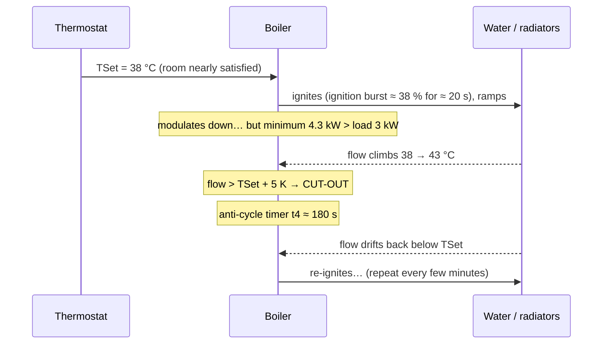
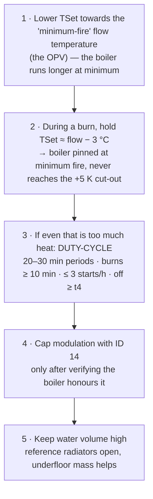

# 05 · Low load and short cycling: the binding constraint

[← 04 Control strategies](04-control-strategies.md) · [Index](README.md) · Next: [06 DHW tank →](06-dhw-tank.md)

> The Tera cannot burn below **4.3 kW**. A house with a 10 kW design loss needs less than that whenever it's warmer than about **+6 °C** outside, which is much of the Hungarian heating season. Below that point the boiler *must* switch on and off. **How** it cycles is worth as much efficiency as everything else in this guide.

## 1. Why cycling hurts

UCL analysed 221 UK boilers: a **median of 53 starts per day**, and 70 % of heating burns averaged **under 10 minutes**. The boilers, "despite available modulation, are unable to prevent rapid on-off cycling" ([UCL](https://discovery.ucl.ac.uk/10054754/1/StartStop_BG_Paper_BSERT_v4_final_main_updated_figures_references.pdf)). The lab penalty per burn:

| Burn length | 1 h | 180 s | 120 s | 60 s | 30 s | 10 s |
|---|---|---|---|---|---|---|
| Efficiency change | 0 | −1.5 % | −2.3 % | −4.1 % | −6.8 % | −11.8 % |

Unburnt hydrocarbons run about **120×** higher in 150 s cycles. A 1–3 minute burn pattern costs **as much as the whole compensation gain** at radiator temperatures. Vendors ask for **2–3 cycles per hour (≤ 5 acceptable)** and about 10 min minimum burns, so the return has time to reach condensing temperature.

## 2. How a modulating boiler ends up cycling

An Immergas Victrix Omnia/Zeus owner with a DIYLESS thermostat described exactly this: about 38 % for about 20 s, cut-out at setpoint + 5 K, about 3 min wait. They "cannot really modulate under 40 degrees… for any reasonable amount of time" ([diyless #34](https://github.com/diyless/opentherm-thermostat3/issues/34)). Their workaround was raising the boiler's minimum setpoint (t0) to 30–35 °C and lowering the ignition fan speed (S2).

## 3. The levers, in order

### The SAT recipe (the best open reference)

SAT ([pwm.py](https://github.com/Alexwijn/SAT/blob/master/custom_components/sat/pwm.py), [README](https://github.com/Alexwijn/SAT)):
1. **Calibrates the OPV** (overshoot protection value): the stable flow temperature the boiler reaches at minimum fire. Defaults are 62 °C for radiators and 45 °C for underfloor.
2. When the computed setpoint falls below the OPV, it switches to **PWM**, using a duty cycle d = (requested − base)/(flow − base):
   - 4 cycles/h on a 900 s base period;
   - minimum ON and OFF of 180 s each;
   - d < 10 % ⇒ stay off;
   - periods stretched to 30 min.
3. **During ON, it holds the setpoint at flow − 3 °C**, pinning the burner at minimum fire.
4. A **flame-health classifier** rates the boiler HEALTHY at ≤ 2 cycles/h, and SHORT_CYCLING when the median burn is under 162 s at more than 3 cycles/h.

▶ Deeper: why "flow − 3 °C" works

The boiler's own logic modulates to bring flow towards TSet, and cuts out at TSet + margin (≈ 5 K).
- If the thermostat keeps resetting TSet to *flow − 3*, the boiler sees "too hot" and drops to minimum fire.
- The cut-out threshold moves up with the flow (flow − 3 + 5 = flow + 2), so it's never reached.
- The thermostat, not the boiler, decides when the burn ends: after ≥ 10 min, when the duty-cycle ON time is over.

**Caveat:** this assumes the boiler cuts out relative to TSet, which needs verifying on the Tera (bench test 13). The flow is still bounded by the boiler's own limits (t1, overheat thermostat).

### ID 14 (max modulation): the second lever, with care

Boilers differ:
- one answered `UNKNOWN-DATAID`;
- a tado that wrote ID 14 every 6 s stopped the boiler modulating;
- another boiler stuck at low flame until ID 14 = 100 % was written.

Netatmo is criticised for leaving modulation at 100 % and moving only the setpoint, which short-cycles. **Leave ID 14 at default until bench test 10 proves the Tera honours it.**

## 4. See it

In [room-sim.html](interactive/room-sim.html), set outdoor +10 °C and water volume 30 L, then compare B (plain PI) with C (PI + anti-cycling). In our runs:
- **B:** about 3.8 starts/h, a median burn of about 3.5 min, and 94 % of burns under 10 min;
- **C:** about 1.6 starts/h, burns of about 12 min, almost none under 10 min, with the same comfort.

Then try [heating-curve.html](interactive/heating-curve.html): the red zone shows from which outdoor temperature your house is below the boiler's minimum.

## ✅ Check yourself

1. Design loss 12 kW at −13 °C (room 21 °C). Above what outdoor temperature must the Tera cycle?
2. Why not simply set a very low TSet (say 30 °C) and let the boiler cope?
3. Why should DHW burns be excluded from the CH starts-per-hour limit?

Answers

1. UA = 12/34 = 0.353 kW/K. The load equals 4.3 kW when 21 − T_out = 4.3/0.353 = 12.2 K, i.e. **above ≈ +8.8 °C**.
2. The boiler can't deliver less than 4.3 kW. Water heats past TSet + 5 K, it cuts out, waits t4 and re-ignites: classic short cycling, often with an ignition burst each time.
3. DHW burns come from the tank's own call, with priority. Counting them would make the CH controller block heating needlessly, and they distort the CH KPI. Count them separately.

## 🔧 What this means for our thermostat

- Implement **duty-cycle mode below the measured minimum-fire temperature**: 20–30 min periods, ≥ 10 min burns, ≤ 3 CH starts/h, off ≥ t4 + margin. OFF means CH bit cleared **and** ID 1 = 10 °C.
- **Hold TSet ≈ flow − 2…3 °C** during stable burns at minimum fire.
- **Measure the OPV** on the real boiler (bench test 12) rather than guessing.
- Log flame edges and compute starts per hour, burn-length distribution and SAT-style flame health. These are the first KPIs to watch (ch. 09).
