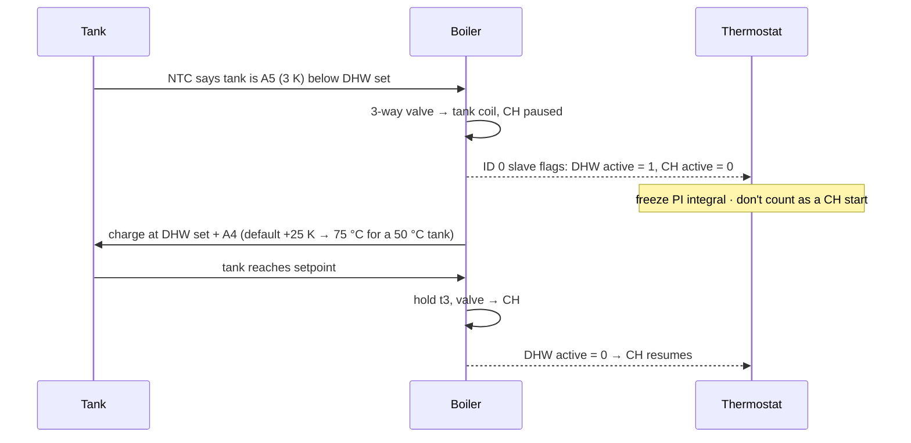

# 06 · Domestic hot water with an external tank

[← 05 Low load](05-low-load-cycling.md) · [Index](README.md) · Next: [07 Hydraulics, zones, TRVs →](07-hydraulics-zones-trvs.md)

The Tera **Plus** is a system boiler built to feed a separate tank through its **internal 3-way diverter valve**. How the tank is wired decides what the thermostat can see and control. The connection method isn't decided yet, so this chapter compares the options.

## 1. Three ways to connect a tank

| Option | How | What the boiler does | What the thermostat can do | Verdict |
|---|---|---|---|---|
| **A: boiler diverter + tank NTC** | Tank sensor (NTC, "B2") on terminals **36–37**, R8 removed; tank coil on the boiler's 3-way valve | Boiler runs DHW **priority**: charges when the tank drops A5 (3 K) below setpoint, at flow = DHW setpoint + A4 (25 K) | DHW-enable bit (ID 0), read tank temperature (ID 26, if exposed), maybe the DHW setpoint (ID 56) | ✅ **Designed for the Tera Plus**; recommended |
| B: tank thermostat on boiler terminals | Mechanical tank stat instead of NTC | Boiler charges on the stat's call | Enable bit only; temperature set on the tank | ⚠️ Possible on some boilers; error E12 and info d0.7 show the Tera expects a sensor |
| C: external zone valves ("S-plan") | Separate valves and stats; boiler just sees "demand" | DHW looks like CH demand | Thermostat can't distinguish DHW from CH | ❌ Fights low-temperature CH; avoid in an OpenTherm design |

Sources: [V1 manual §3.11](https://www.immergas.com/media/Prodotto/63cc198a3fdcb6a15d98b7c7/Victrix-Tera-Plus-24-1046002_002_01180.pdf), [Worcester Bosch](https://worcester-bosch.co.uk/support/literature/download/6720816348), [tado community](https://community.tado.com/en-gb/discussion/comment/45099).

## 2. How priority works (option A)

## 3. Three Tera-specific points

1. **With P7 = 2 the DHW setpoint "stays on the boiler panel"** (V2 manual), so ID 56 writes may be ignored. The Nest on a Tera could only set the DHW *maximum*. The thermostat's reliable lever is the **DHW-enable bit**: it decides *when* the tank may charge.
2. **No automatic anti-legionella.** The tank exceeds 60 °C only when a suitable Immergas control triggers it. HSE guidance is storage at ≥ 60 °C, with water reaching 50 °C at outlets within 1 minute ([HSE](https://hse.gov.uk/legionnaires/hot-and-cold.htm)). Manufacturer practice is a weekly pasteurisation cycle. If ID 56 is writable, the thermostat can do a weekly 60–65 °C cycle; otherwise this is a manual or panel routine.
3. **Tank charging never condenses with the defaults.** A4 = 25 K means a 50 °C tank is charged with 75 °C water. Lowering A4 towards 10–15 K, if the tank coil is big enough, shortens the non-condensing period at the cost of longer charges. That's an installer and tank-sizing question.

▶ Deeper: scheduling DHW smartly

- **Charging windows:** enable DHW, for example, 05:30–07:00 and 17:00–20:00. Outside the windows, with the enable bit cleared, the tank coasts. Fewer, larger charges mean fewer burner starts.
- **Piggy-back on CH:** in mild weather, when CH is duty-cycling, enabling DHW right after a CH burn avoids an extra cold start.
- **Comfort guard:** if the tank temperature (ID 26) falls below a minimum, enable DHW regardless of the schedule.
- **ID 17 can exceed 100 % during DHW** on Immergas (tank output 28 kW vs 24 kW CH), so clamp it for display and compute energy separately.

## ✅ Check yourself

1. Why is option C (zone valves) bad for an OpenTherm-modulating system?
2. The thermostat writes ID 56 = 65 °C for a legionella cycle and gets `WRITE-ACK`. Is the job done?
3. What should the CH controller do while DHW active = 1?

Answers

1. The boiler can't tell DHW demand from CH demand. It sees one demand, often needing a high flow temperature for the tank, which wrecks low-temperature CH and confuses the room controller.
2. Not necessarily. With P7 = 2 the panel may own the DHW setpoint. Read back ID 56, watch the tank temperature (ID 26 / d0.7) and check the panel. Bench test 8 settles this.
3. Freeze the PI integral, pause the anti-cycling counters for CH, and not count the burn as a CH start.

## 🔧 What this means for our thermostat

- Recommend **option A** to the installer (Immergas tank or a compatible NTC on 36–37) and ask about coil size and A4.
- Control DHW via **scheduled enable windows**; read the tank temperature if available; try ID 56 only after verifying it's honoured.
- Plan the **legionella strategy** explicitly.
- Handle DHW-active in the CH loop: freeze the integral, keep separate counters and KPIs.
