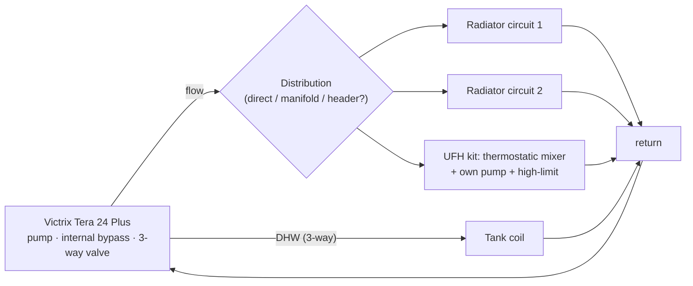

# 07 · Hydraulics, zones and TRVs

[← 06 DHW tank](06-dhw-tank.md) · [Index](README.md) · Next: [08 Reference projects →](08-reference-projects.md)

> **The installation sets the ceiling; firmware can only approach it.** Header, bypass, pump mode and balancing bound the achievable efficiency more than any algorithm.

Our planned system: one boiler feeding **2 radiator circuits** and **1 underfloor circuit** behind a thermostatic mixing valve, plus the DHW tank. More room sensors come later, possibly smart TRVs.

## 1. Headers, bypasses and minimum flow

- A **low-loss header** (or close-coupled tees) decouples several pumps. If the boiler-side flow is bigger than the system-side flow, hot supply goes straight back into the return and **kills condensing** ([Heat Geek](https://www.heatgeek.com/low-loss-headers/)). Underfloor needs about 3× the flow of radiators, which is the usual reason it gets its own pump and separation. Modern internal pumps (about 7 m head) often make a header unnecessary.
- **Bypasses** have the same effect whenever they pass flow. This includes automatic bypass valves and the **Tera's internal bypass, which leaves the factory open**.
- **Balancing:** boilers condense about 5 % of the time unbalanced vs about 80 % balanced (Danfoss-cited field data).

## 2. The underfloor circuit behind a thermostatic mixer

A fixed-point thermostatic mixing kit (typically 20–60 °C, with its own pump) can **only mix down**:
- **Cold weather:** boiler flow (e.g. 50 °C) is above the mixer setting (e.g. 35 °C). The mixer throttles and recirculates, and the floor return (about 30 °C) is cool, which helps condensing.
- **Mild weather:** boiler flow (e.g. 33 °C) is below the mixer setting. The hot port opens fully and the floor gets whatever the boiler delivers, which may be too little.

With one flow setpoint, the thermostat must send **max(radiator need, UFH need + about 5 K)** while the floor is in demand, or accept a cooler floor on mild days. [heating-curve.html](interactive/heating-curve.html) draws the floor line.

- **CH2 (ID 8)** would allow a separate setpoint, but "very few boilers allow you to control the second zone"; the Tera documents nothing. Probe ID 3 bit 5 and expect "no".
- A **motorised, weather-compensated mixer** would decouple the two circuits later.
- **Screed and pipe protection must be an independent mechanical high-limit** on the UFH flow, typically 50–55 °C, cutting the UFH pump. Never rely on firmware alone. The Tera manual also asks for a safety thermostat when used directly for low-temperature circuits.

## 3. Many rooms, one boiler: aggregating demand

| Approach | How | Pros / cons |
|---|---|---|
| **Single reference room** (Phase 1) | One sensor drives TSet; that room's radiator never closes | Simple, stable; other rooms rely on TRVs / balancing |
| **Max-demand** (evohome) | Each valve reports 0–100 %; zone = max of its valves; boiler = max of zones → TSet | Nobody is cold; but one room can drive the whole system hot ([evohome wiki](https://github.com/zxdavb/The-Evohome-Protocol/wiki/3150:-Zone-Heat-Demand)) |
| **Main + capped boosts** (recommended for Phase 3) | Reference-room PI, plus deadbanded, capped boosts (≤ +5 K on TSet after N min of sustained error) from secondary rooms, weighted | Efficient, tolerant of one odd room |
| **Average valve position** | Boiler target from the mean valve opening | Smooth; weak with cheap TRVs that report only 0/100 % |
| **Count / power threshold** (Versatile Thermostat) | Boiler on when N rooms or X W of demand | Good for on/off boilers |

## 4. TRVs: friends or foes?

TRVs fight compensation: "braking and accelerating at the same time." Heat Geek's worked example ([article](https://heatgeek.com/articles/why-not-to-zone-heat-pumps-or-boilers)):
- set 2 of 4 rooms to 18 °C: heat loss drops only about **4–6 %**;
- but the active radiators' mean water temperature rises from **about 46 to 51.5 °C**;
- with rooms fully off, the flow needs about **64 °C**.

Rules that work:
- a **reference room without a TRV head**, holding the control sensor;
- **TRVs as limiters**, set 1–3 K above target under weather compensation;
- when **every valve except the reference is closed**, clear CH enable rather than just lowering TSet; otherwise the bypass and short cycling follow;
- **real hydraulic balancing**: lockshields, or dynamic, pressure-independent valve inserts;
- smart TRVs: use **external-sensor calibration** (Better Thermostat style); cheap TRVs' valve-position feedback is poor.

## ✅ Check yourself

1. Mild day: radiators need 33 °C flow, the floor mixer is set to 35 °C. What does the floor get, and what can the thermostat do?
2. Why can turning off two bedrooms *increase* gas use per unit of heat?
3. Why must the UFH high-limit be mechanical?

Answers

1. The mixer's hot port is fully open, so the floor gets about 33 °C and under-heats. Either raise TSet to about 40 °C while the floor demands (costing some radiator efficiency) or accept a slightly cooler floor. Long term, fit a motorised mixer.
2. The remaining radiators must deliver nearly the same heat with less surface, so the flow temperature rises, the return rises and condensing drops. The heat saved is only a few percent.
3. Firmware and HA can crash, misbehave or be mis-configured. Protecting screed and pipes is a safety function that must work without them ([full report §11](full-report.md#11-safety-the-boiler-owns-the-hazards-the-firmware-owns-the-failure-direction)).

## 🔧 What this means for our thermostat

- Ask the installer the hydraulics questions (header, bypass, pump mode, balancing, UFH kit and high-limit) before the boiler goes in. See the [checklist](10-recommendation-phase1.md#installer-checklist).
- Phase 1: **one reference room** (the SHT40's room) with a radiator that never closes.
- Implement the **UFH floor** on TSet while the floor is in season, as a configurable rule.
- Phase 3+: capped, deadbanded boosts from extra rooms; TRVs as limiters; CH off when all valves are closed.
