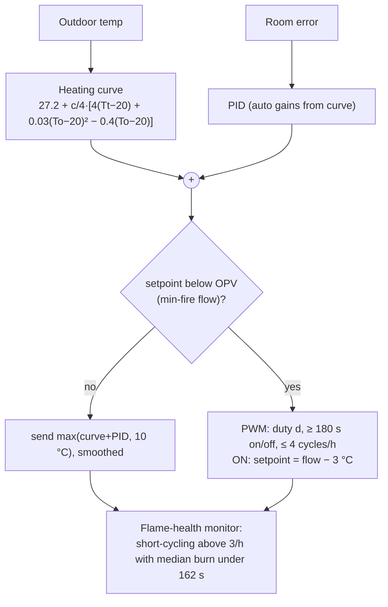

# 08 · Reference implementations: what others built

[← 07 Hydraulics](07-hydraulics-zones-trvs.md) · [Index](README.md) · Next: [09 Learning, data, KPIs →](09-learning-data-kpis.md)

The open-source projects and commercial products converge on one recipe: **heating curve + PI trim, a never-stopping message loop, and explicit anti-cycling**. Most of the code was read directly (SAT at commit 7d43560, Versatile Thermostat, Better Thermostat, Ihor Melnyk's library). Commercial algorithms are unpublished, so those rows rest on documentation and user reports. Details: [notes/reference_implementations.md](notes/reference_implementations.md).

## Overview

| Project | What it is | What to copy | Source |
|---|---|---|---|
| **OTGW** (Schelte Bron) | Gateway between an existing thermostat and the boiler; monitor mode GW=0, gateway GW=1 | Setpoint "vigilance": overrides must be refreshed ≤ 60 s or they're dropped. 3× `UNKNOWN-DATAID` ⇒ unsupported. Watchdog reset ⇒ hardware pass-through | [otgw.tclcode.com](https://otgw.tclcode.com/firmware.html) |
| **ESPHome OpenTherm** | Master-only hub plus a generic `pid` climate on `t_set` | Status every cycle, config once; **use `ch_enable` to stop heating**; frame-rewrite hooks for odd boilers | [esphome.io](https://esphome.io/components/opentherm/) |
| **Ihor Melnyk library** | Arduino/ESP interrupt library | Request/response state machine, 1 s timeout, 100 ms gap | [GitHub](https://github.com/ihormelnyk/opentherm_library) |
| **DIYLESS** | Master shield (MCU-powered, polarity-free); Thermostat 3 firmware | Hardware proven on Immergas; its issues document Immergas cycling | [diyless #34](https://github.com/diyless/opentherm-thermostat3/issues/34) |
| **SAT** (Smart Autotune Thermostat) | Home Assistant integration: curve + PID → ID 1 | Auto-scaled gains; **OPV calibration**; **low-load PWM with flow − 3 °C hold**; flame-health classifier; dynamic minimum from return temperature | [GitHub](https://github.com/Alexwijn/SAT) |
| **Versatile Thermostat** | HA TPI: on% = c_int·ΔT_in + c_ext·ΔT_out | TPI as the on/off fallback; central-boiler thresholds with activation delay | [GitHub](https://github.com/jmcollin78/versatile_thermostat) |
| **Better Thermostat** | HA TRV wrapper with external-sensor calibration (incl. MPC/TPI/PID modes) | Phase 4 TRV calibration; doesn't drive the boiler | [GitHub](https://github.com/KartoffelToby/better_thermostat) |
| **OTGateway** (Laxilef) | The most complete OSS standalone ESP master: equitherm + PID + hysteresis | **Immergas fix (0xCA)**, ID 57 sync, emergency mode on Wi-Fi/MQTT/sensor loss, 5 retries before "disconnected" | [GitHub](https://github.com/Laxilef/OTGateway) |
| **Commercial** (Nest, tado, evohome, Netatmo, Vaillant) | Proprietary | Curve + room trim + learned preheat + user flow cap; Nest is ErP Class VI on OpenTherm | [Nest True Radiant](https://support.google.com/googlenest/answer/9250165) |

## How SAT decides a flow temperature

▶ Deeper: where the projects disagree or are unclear

- **SAT's overshoot calibration:** the README says it uses MM = 0 and CS = 75 °C, but the code uses modulation 100 % and per-system setpoints ([overshoot_protection.py](https://github.com/Alexwijn/SAT/blob/master/custom_components/sat/overshoot_protection.py)). We'll measure the OPV on the real boiler instead (ch. 10, test 12).
- **Summer/winter bit (v4 ID 0 bit 5):** OTGW's code comment and ESPHome's naming disagree on its polarity. Don't set it.
- **Immergas TSP 12:** SAT and OTGW-firmware write it; nobody knows what it does. Don't.
- **evohome** demand logic comes from community reverse-engineering, not Honeywell docs.
- **Netatmo:** users report modulation left at 100 %, which causes short-cycling.

## Two lessons

1. **A plain PID on the flow setpoint is the minimum viable approach, not a good one.** SAT exists largely because that approach cycles badly. Explicit minimum-fire and modulation management is what separates the good controllers, and commercial products often skip it.
2. **Keep the brain in the thermostat.** SAT runs inside Home Assistant and therefore recommends a physical backup thermostat for when HA fails. Our project's advantage is that the control loop lives on the device: **HA advises, the MCU decides.**

## ✅ Check yourself

1. Which project's Immergas workaround do we plan to reuse, and what exactly does it change?
2. Why does OTGW drop an override setpoint that isn't refreshed within a minute?

Answers

1. OTGateway's "Fix for Immergas boilers": the ID 0 status request is sent with low byte 0xCA instead of 0x00. Nothing else changes; ID 57 sync is a separate option.
2. So that a crashed or disconnected controller can't leave the boiler stuck at a high setpoint. It's the "vigilance" safeguard against runaway heating.

## 🔧 What this means for our thermostat

- Borrow SAT's **ideas** (OPV, PWM with flow − 3 °C hold, flame health, curve formula) and OTGateway's **Immergas byte**, implemented natively in ESP-IDF.
- Borrow OTGW's **vigilance** idea for anything Home Assistant pushes to the thermostat: parameters time out to safe defaults.
