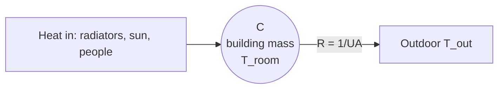
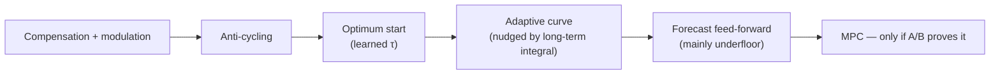
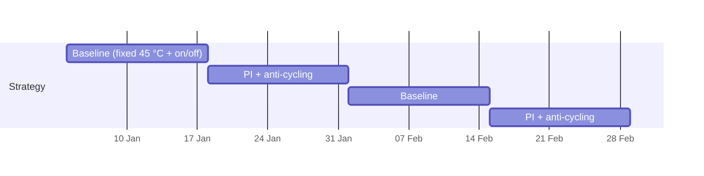

# 09 · Learning, data and efficiency KPIs

[← 08 Reference projects](08-reference-projects.md) · [Index](README.md) · Next: [10 Recommendation →](10-recommendation-phase1.md)

> Machine learning pays off here first as **simple grey-box system identification**: a learned building time constant for optimum start and a self-correcting heating curve. MPC and reinforcement learning come much later, if ever. None of it can be proven without **logging everything from day one, including a gas-meter reading**.

## 1. A thermal model of the house in one line

The simplest useful model is **1R1C**: one heat capacity *C* (the building) and one resistance *R = 1/UA* to outside.

$$C\frac{dT_{room}}{dt} = Q_{heat} + Q_{sun} - UA\,(T_{room}-T_{out})$$

Discretised as an ARX model, which can be fitted on the ESP32-P4 with **recursive least squares**:

$$T_{k+1} = a\,T_k + b_1 T_{out,k} + b_2\,u_k + b_3\,I_{sol,k} + c$$

The key learned quantity is **τ = RC**, the building time constant. It tells the thermostat how long a heat-up takes (**optimum start**) and how deep a setback is worth.

▶ Deeper: what the literature says

- **Choosing model order:** Bacher & Madsen's likelihood-ratio forward selection over stochastic RC models is the reference method ([DTU](https://orbit.dtu.dk/en/publications/identifying-suitable-models-for-the-heat-dynamics-of-buildings/)). CTSM-R implements continuous-discrete Kalman-filter maximum likelihood.
- **How much data:** a 2025 study fitted 1-state and 2-state models with CasADi + IPOPT on **21 days of 10-minute data**. It reached about **89 % accuracy (100 − MAPE)**; the 1-state model was as good as the 2-state one, and more data didn't help. The data was simulated, not measured ([arXiv 2510.21044](https://arxiv.org/html/2510.21044v1)).
- **The identifiability trap:** a well-controlled room barely moves, so the model can't tell heating from losses. Setbacks, setpoint steps and free-floating cool-downs provide the "excitation". Sun and internal gains are the main unmodelled disturbances.

## 2. MPC and RL: a reality check

A 2025 review of MPC/RL field demonstrations ([arXiv 2503.05022](https://arxiv.org/html/2503.05022v6)) found:
- average savings of **22 % energy and 16 % cost** after filtering;
- but **71 %** of demonstrations used protocols that may be unreliable: tests under a week, simulated baselines, partial-room control;
- only 3 of 23 residential papers reported confidence intervals;
- one residential deployment took **190 engineer-days**;
- no clear residential gas-boiler example. Much of the MPC benefit comes from time-of-use tariffs, which flat gas pricing doesn't offer.

**Priority ladder:**

## 3. Who does what

| On the thermostat (ESP32-P4) | In Home Assistant / Python |
|---|---|
| OpenTherm bus, clamps, watchdog, fallbacks | Weekly batch re-fits (scipy, CasADi) |
| PI + curve, anti-cycling, schedule | KPI computation, dashboards |
| Optimum start from τ, RLS updates | A/B test scheduling and analysis |
| Bounded parameters in NVS | Forecast feed-forward |
| **Runs indefinitely without HA** | Pushes only **range-checked** parameters, which time out to defaults |

## 4. What to log from day one

| Signal | Source | Rate | Why |
|---|---|---|---|
| Room temp + RH (raw, 0.01 °C), calibration offset | SHT40 (+ later sensors) | 30–60 s | Control, model, comfort |
| Room setpoint, mode, schedule state | Thermostat | on change | Separate user-driven from control-driven changes |
| TSet sent, value ACKed, controller internals (base, P, I, duty state, active limits) | Thermostat | every write | Tuning; the ACK reveals clamping |
| ID 0 flags (CH, DHW, **flame**, fault) | Boiler | every cycle + edges | **Burner starts and burn lengths** |
| ID 25 flow, **ID 28 return**, ID 17 modulation | Boiler | 10–30 s | Condensing and modulation KPIs, energy proxy |
| ID 18 pressure, ID 26 tank, ID 27/33 if any | Boiler | 1–5 min | Leaks, DHW, flue |
| ID 5 / 115 fault codes | Boiler | on change | Fault mapping |
| ID 3, 15, 48, 49, 57, 125, 127 + support map | Boiler | boot | Configuration record |
| ID 116–123 counters | Boiler | hourly | Cross-check edge counts |
| Outdoor temperature (labelled source) | HA / own sensor | 5–15 min | Curve, degree-day normalisation |
| Solar (irradiance, or PV power as proxy) | HA | 5–15 min | Solar-gain term |
| **Gas meter** (pulse or smart port) | Meter | pulses / 5 min | **Ground truth**; split CH/DHW by flags |
| Window, occupancy, camera motion | HA / device | on change | Disturbances |
| OT errors/timeouts, latency, RSSI, reboots, reset reason, firmware + strategy ID | MCU | 5 min / on change | Reliability, A/B tagging |

Store timestamps in UTC (NTP). Keep a few days in an on-device ring buffer so HA or Wi-Fi outages don't leave gaps. Use long-term storage (InfluxDB / VictoriaMetrics) rather than HA's short default recorder history.

## 5. Efficiency KPIs

| KPI | Formula / definition | Target |
|---|---|---|
| **Gas per heating degree day** | slope *b* of E_day = a + b·HDD(T_base) | ↓ vs baseline |
| **Starts per day / per burner-hour** | flame rising edges (CH only) | ≤ 2–3/h, ≤ 5 acceptable |
| **Median burn length**, % burns < 10 min | from flame edges | ≥ 10 min; few short |
| **% burner time with return < 55 °C** (strict: < 50 °C) | from ID 28 while flame on | ↑ high |
| Flame-weighted mean return | | ↓ |
| Mean modulation; % time at minimum | ID 17 while firing | high % at min ⇒ oversizing signature |
| **Comfort degree-hours** below setpoint − 0.5 K | | must not rise; "savings" from a colder house don't count |

**Energy from modulation:** P ≈ P_min + RelMod·(P_max − P_min). This is ±10–30 % until calibrated against the gas meter, because RelMod semantics are boiler-specific (ch. 03).

### A/B testing a control change

- Use blocks of **≥ 7 days, ideally 14**, and discard 1–2 days after each switch (thermal-mass carry-over).
- Keep comfort setpoints identical, and tag every record with the strategy ID.
- Fit the energy signature with a strategy dummy to get a **confidence interval**. Shorter tests are the documented path to inflated claims.

## ✅ Check yourself

1. Why can't we just compare January's gas use with February's to judge a new controller?
2. The house barely changes temperature all week. Why might the 1R1C fit be poor, and how do we fix it?
3. Why is "% of burner time with return < 55 °C" a better KPI than mean flow temperature?

Answers

1. Weather differs between months. Normalise by heating degree days, alternate strategies in blocks, and compare slopes with confidence intervals.
2. With no excitation, the data can't separate heat input from losses. Add setbacks, setpoint steps or cool-down periods; include solar and outdoor terms.
3. Condensing depends on the return temperature at the heat exchanger. A low flow can still give a high return with a bypass, a fast pump or DHW, and the KPI captures what actually matters.

## 🔧 What this means for our thermostat

- Build the **logging pipeline before the boiler is installed** (Phase 0), including a gas-meter reader.
- Run a **2-week baseline** with a simple fixed configuration before enabling PI, so later savings can be proven.
- Start learning with **RLS on a 1R1C model on the device** for τ and optimum start; do heavier fits in HA.
