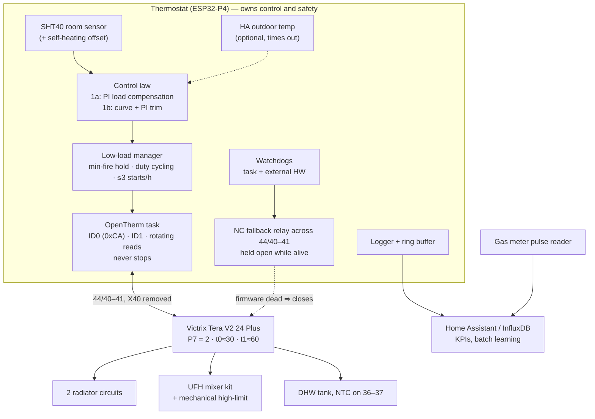

# 10 · Recommendation for Phase 1

[← 09 Learning, data, KPIs](09-learning-data-kpis.md) · [Index](README.md)

This chapter pulls the research together into a **proposed** design. It is advice for you to decide on, not an implementation. Every numeric default is a starting point to confirm with the boiler tests below. It combines cited findings with engineering judgement; see [full-report.md §11–15](full-report.md#12-recommended-phase-1-control-design) for the sources.

## 1. The design at a glance

## 2. Prerequisites: boiler and wiring

- Buy a **Victrix Tera V2 24 Plus EU** (code 3.032933), and confirm it on the order and rating plate.
- Installer settings:
  - **P7 = 2**, then power-cycle;
  - **t0 ≈ 30 °C, t1 ≈ 60 °C**, so the boiler itself caps what the thermostat can ask for;
  - P4 = 0 (pump follows demand), A3 constant ΔT 15–20 K;
  - internal bypass as closed as the minimum-flow requirement allows;
  - A4 lowered towards 15 K if the tank coil supports it.
- Don't fit the boiler's outdoor sensor for now (or fit it and test its interaction).
- Wire the DIYLESS shield (GPIO29 in / GPIO30 out) to **44/40–41** with **X40 removed**.
- Add a **normally-closed fallback relay** across the same pair. It is held open by an external **hardware watchdog** that the firmware must keep toggling.
- Fit a **mechanical high-limit thermostat** on the UFH flow that cuts the UFH pump.

## 3. Bus layer

- A dedicated high-priority task with hardware-timed transmit and edge-timestamped receive (as now).
- **Every ≈ 1 s cycle:** ID 0 READ, with HB = CH/DHW flags and LB = **0xCA** (a configurable flag), then ID 1 WRITE, then **one rotating slot**:
  - 25 flow, 17 modulation, 28 return, 18 pressure, 26 tank;
  - 5 faults, when the fault bit is set;
  - the 57 mirror write;
  - 116–123 counters, hourly.
- **Start-up:** ID 0 ×N, then ID 3; write ID 2 (0) and ID 124 = 2.2; read 125/127, 15, 6, 48/49; probe the optional IDs.
- **Support map:** 3× `UNKNOWN-DATAID` / `DATA-INVALID` ⇒ unsupported. Re-probe hourly and after a reconnect.
- **Link lost** only after about 5 s of consecutive failures. Alarm, but **keep transmitting**: the cadence never stops, including during OTA and Wi-Fi reconnects.

## 4. Control law

**Phase 1a (indoor sensor only): load compensation**

$$T_{Set} = \mathrm{clamp}(T_{base} + K_p e + I,\; T_{low},\; T_{max})$$

- T_base = 35 °C, Kp ≈ 10–15 °C/K, Ti ≈ 2–3 h, no D. Sample every 60 s, deadband 0.1 K, rate limit ≈ 1 K/min.
- **Freeze the integral** during DHW-active, duty-cycle OFF, anti-cycle waits and saturation.
- T_max = 55 °C for radiators (up to 60 °C only if the reference room can't reach setpoint on design days); T_low = the measured minimum-fire temperature.
- While the floor is in season: TSet ≥ UFH mixer setting + 5 K (configurable).

**Phase 1b (+ HA outdoor temperature):** SAT-style curve as feed-forward, with the PI as trim bounded to ±10 K. Automatic fallback to 1a when HA data is older than 30 min.

**Low load and anti-cycling** (ch. 05):
- During a stable burn at minimum fire, hold **TSet ≈ flow − 2…3 °C**.
- When the requested TSet is below the minimum-fire temperature, switch to **duty cycling**: 20–30 min periods, burns ≥ 10 min, off ≥ t4 + margin, **≤ 3 CH starts/h**.
- **"Off" = CH bit cleared + ID 1 = 10 °C.**
- Leave ID 14 at default until verified. Never write TSP 12.

**DHW** (ch. 06):
- Scheduled DHW-enable windows, plus a top-up after CH runs; read ID 26 if available.
- A weekly pasteurisation via ID 56 only if a read-back proves writes work.
- Exclude DHW burns from the CH counters and KPIs.

## 5. Safety and failure direction

| Failure | Risk | Tera behaviour | Mitigation |
|---|---|---|---|
| Firmware hang, line idle | Spec: idle-low ≥ 5 s may mean "heat" | Unknown with P7 = 2; E31 likely | Hardware watchdog; test both directions |
| MCU unpowered / shield dead | No control | E31; after a power cycle **no CH** | NC relay across 44/40–41 ⇒ boiler heats on its own setpoint (verify no power cycle needed) |
| Missed replies | Routine | 17.6 % seen on one Immergas | 1 s timeout, retries, loss only after about 5 s |
| **Room sensor fails** | Over- or under-heating | — | Fallback ladder: HA sensor → outdoor curve → **fixed 40–45 °C with a duty limit**; alert. *Replaces today's "heating off after 30 s"* |
| HA / Wi-Fi lost | — | — | Local schedule and curve; HA-pushed parameters time out to defaults |
| CH-off ignored | Keeps firing | Reported on Immergas | CH bit cleared + ID 1 = 10 °C |
| Bad parameter from HA or OTA | Runaway setpoint | — | MCU-side range checks; OTA rollback, marked valid only after the OT and sensor self-test |
| Frost | Burst pipes | Boiler frost function (4 °C water) | Firmware frost floor: room < 5–7 °C ⇒ CH at a low setpoint, independent of schedule and HA |

Layers, in order:
1. The boiler's certified controls.
2. Independent hardware: the UFH high-limit and the fallback relay.
3. Firmware clamps.
4. Home Assistant.

Layers 3 and 4 never protect screed or pipes. Under IEC/EN 60730-1 Annex H this keeps the thermostat software in **Class A** (not relied upon for safety).

## 6. Roadmap

| Phase | Hardware | Control | Learning / data | Exit criterion |
|---|---|---|---|---|
| **0** (now) | Bench + simulated boiler | Bus stack with Immergas flags; failsafe state machine; logging pipeline | Schema in place | Simulated comm loss, sensor loss and OTA rollback pass |
| **1a** | Tera V2 + shield + fallback relay; SHT40 in the reference room; gas pulse reader | **2-week fixed baseline**, then PI + anti-cycling + DHW schedule | KPIs live | All boiler tests pass; ≤ 3 starts/h; no E31 in a week |
| **1b** | + HA outdoor temperature | Curve + PI trim, stale-data fallback | Fit the curve coefficient from integral history | Integral ≈ 0 across outdoor temperatures |
| **2** | Own sited outdoor sensor | Curve on measured T_out; 1–3 K setback; optimum start | RLS 1R1C on device; weekly 2R2C in HA | Recovery on time ± 15 min; no comfort loss in A/B |
| **3** | 2+ more room sensors | Capped deadbanded boosts (≤ +5 K), weights (Class VIII) | Per-room models; data-guided balancing | No single room drives the flow up persistently |
| **4** | Smart TRVs, dynamic valve inserts | Valve-position demand with thresholds; reference radiator TRV-free; CH off when all closed | TRV calibration | Return temperature and starts no worse than Phase 3 |
| **5** | — | Forecast feed-forward (UFH); optional MPC | Offline grey-box + MPC; strict A/B | Significant saving with CI, or stop |

## Verify on the real boiler

| # | Item | Method | Pass / note |
|---|---|---|---|
| 1 | V1 vs V2 | Rating plate / code 3.032933; installer menu offers P7 0/2; record d1.9 | V2, P7 = 2 set and power-cycled |
| 2 | Bus voltage | Meter on 44/40–41, X40 removed, nothing connected | ≈ 15–18 V; 24–35 V = stop |
| 3 | Terminals and polarity | Continuity 40↔44; note the pair used | Documented |
| 4 | First contact and 0xCA | ID 0 with LB 0x00, then 0xCA; log replies and whether writes take effect | Known which is needed |
| 5 | Reply statistics | 24 h latency histogram, miss rate per ID | Misses < 1–2 %, latency ≪ 800 ms |
| 6 | Identity and capabilities | Read ID 3, 125, 127, 15, 6, 48, 49, 93–95 | MemberID (expect 27), min modulation, bounds |
| 7 | Which setpoint it heats to | ID 57 = 60; step ID 1 30→45→40; repeat without ID 57; watch ID 25, d0.4, d1.7 | Decide whether the mirror is needed |
| 8 | ID 56/57 writable with P7 = 2 | Write, read back, check panel | ACK vs effect noted |
| 9 | CH-off semantics | Clear the CH bit with ID 1 = 45; then clear + ID 1 = 10 | Burner off in both cases, or only the second |
| 10 | ID 14 honoured | 0/30/100 % during a steady burn; watch ID 17, fan rpm (d1.5) | Responds, or mark unsupported |
| 11 | ID 17 scaling | Compare with d1.5 at min, at P2, during DHW | ID 17 → kW map; > 100 % in DHW? |
| 12 | Minimum-fire flow (OPV) | Mild day, all radiators open, hold TSet = flow − 3 | Stable temperature recorded |
| 13 | Cut-out overshoot and anti-cycle | Setpoint below steady flow; time the cut-out and re-ignition | t4 = 180 s? margin = +5 K? |
| 14 | Ignition burst and ramp | Log ID 17 / fan rpm for 5 min after ignition | Matches t5 |
| 15 | Pump post-run | Watch the pump after CH off (d1.2, d1.4) | Time recorded |
| 16 | Supported sensors | Probe 18, 19, 26, 27, 28, 33, 34–36, 115, 116–123 | ID 19 absent; ID 28 hoped for |
| 17 | Fault mapping | Benign fault (unplug tank NTC → E12); read ID 0 fault bit, ID 5, ID 115 | E-codes ↔ OT values |
| 18 | Comm loss, line idle-low | Stop TX with the line low; time to E31; does it fire? | Behaviour + timing |
| 19 | Comm loss, line high / shield off | Repeat both ways | Behaviour recorded |
| 20 | Recovery without power cycle | Resume TX after E31 | CH back without a power cycle? |
| 21 | Fallback relay | After E31, close the relay | Heats on panel setpoint (or document the needed power cycle) |
| 22 | Frost function under OT | Stand-by with OT connected | Frost protection active |
| 23 | DHW cycle | Tank call: flags, CH pause, A4 flow, t3 | Enable-bit gating and integral freeze work |
| 24 | Outdoor sensor interaction (if fitted) | Vary ID 1 with the sensor connected | ID 1 wins, or remove the sensor |
| 25 | EMC | Frame error rate with camera, Wi-Fi and display active vs idle | No increase |
| 26 | SHT40 self-heating | Reference thermometer, screen/camera on vs off | Offset recorded and applied |

## Installer checklist

1. Is it a **Victrix Tera V2 24 Plus EU** (3.032933)? Can you confirm it on the order and rating plate, and set **P7 = 2** ("Távvezérlő = 2") and power-cycle?
2. Remote terminals 44/40–41 with X40 removed, and no other thermostat on that pair?
3. Can t0/t1 be set to agreed values (for example 30/60 °C)? What are P1/P2, t4, t5 and S2 as commissioned?
4. Pump mode (A3 ΔT / proportional / fixed), A1/A2 limits, P4 intermittent? Any external pump besides the UFH kit?
5. Internal bypass setting, and the boiler's minimum flow with valves closed? Any external automatic bypass, and at what pressure?
6. Low-loss header, close-coupled tees or a plate heat exchanger? If so, why, and how is primary flow kept ≤ secondary flow?
7. How are the two radiator circuits separated (zone valves → t6, or balancing only)? How will the system be hydraulically balanced?
8. UFH kit: make and model, thermostatic or motorised, set temperature, own pump and its enable logic, oxygen-barrier pipe? **An independent mechanical high-limit that cuts the UFH pump?**
9. DHW tank: an Immergas unit (80/120/200 L) or other? NTC on 36–37 with R8 removed? Coil rating, and can A4 run at 10–15 K?
10. Legionella protection, given the boiler has no automatic cycle?
11. Outdoor sensor on the boiler (38–39)? We prefer not to, or we test the interaction first.
12. The house's design heat loss and design outdoor temperature, and the sum of radiator ΔT50 ratings per circuit? At what outdoor temperature does the load fall below 4.3 kW?
13. Installer menu access: will you record all parameter values at commissioning?
14. Confirm that frost protection stays active in stand-by under remote control.
15. Your recommended recovery after E31, and approval for a volt-free fallback relay across 44/40–41?
16. Is the gas meter suitable for a pulse reader (reed or optical), or does it have a readable port?
17. Commissioning record with fault history (d0.9), software versions (d1.9) and combustion readings at min/max?

## Decisions for you

These are the open choices this research surfaces; none needs to be made today:
- **Fallback relay:** add it in Phase 1 (recommended) or accept "fails cold" with an alarm only?
- **Outdoor temperature source** for Phase 1b: HA weather now, or wait for our own sensor?
- **DHW tank option A** (boiler diverter + NTC; recommended): agree it with the installer.
- **Baseline period:** accept 2 weeks of a simple fixed strategy first, so later savings can be measured?
- **Sensor-failure behaviour:** change today's "heating off after 30 s" to "fixed conservative setpoint" (recommended for this boiler)?
